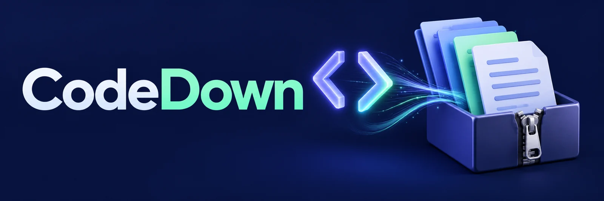

<p align="center"></p>

# CodeDown

**Turn code blocks into files you can use.**

[](https://github.com/tyhallcsu/codedown-chrome-extension) [](manifest.json)

[Start here](#start-here) · [Reference](#project-reference)

<a id="start-here"></a>

A Chrome Manifest V3 extension for downloading individual code snippets or bundling selected blocks into a ZIP. It runs on the ten AI chat sites listed below. Site layouts can change, so use the troubleshooting steps if a button or code block is missing.

## Start in three steps

1. Download this repository using **Code → Download ZIP**, then extract it, or clone it.
2. In `chrome://extensions/`, enable Developer mode and load the folder containing [manifest.json](manifest.json). In this checkout, that is the **repository root**.
3. Refresh a supported chat page. Use a code block's Download button, or press **Alt+Shift+S** to select several blocks in the manager.

## Which download do you need?

| Goal | Action |
| --- | --- |
| Save one snippet | Use its Download button |
| Save selected snippets together | Open the manager, select blocks, download a ZIP |
| Change the shortcut | Open `chrome://extensions/shortcuts` |
| Diagnose missing controls | Follow [Troubleshooting](#troubleshooting) and [View Logs](#view-logs) |

The manifest requests access to the supported sites and declares `storage` and `contextMenus`. Review the [permission explanation](#permissions-explained) and [manifest](manifest.json) before installing. This is a source-loaded extension; this guide does not claim a Chrome Web Store listing.

[Installation](#installation) · [Supported sites](#supported-sites) · [Usage](#usage) · [Troubleshooting](#troubleshooting) · [Credits](#credits)

## Project reference

Add download buttons to code blocks across ChatGPT, Z.Ai, Gemini, LMArena, Kimi, Le Chat, Meta AI, Copilot, Grok, and LongCat. Save snippets as ready-to-use files and organize multiple downloads with an advanced management menu.

## Supported Sites

- ChatGPT (chatgpt.com)
- Z.AI (chat.z.ai)
- Google Gemini (gemini.google.com)
- LMArena (lmarena.ai)
- Kimi (www.kimi.com)
- Le Chat / Mistral (chat.mistral.ai)
- Meta AI (www.meta.ai)
- Microsoft Copilot (copilot.microsoft.com)
- Grok (grok.com)
- LongCat (longcat.chat)

## Installation

### Load Unpacked Extension

1. Open Chrome and navigate to `chrome://extensions/`
2. Enable **Developer mode** (toggle in top-right corner)
3. Click **"Load unpacked"**
4. Select the extracted repository folder containing `manifest.json` (the repository root, regardless of its local folder name)
5. The CodeDown icon should appear in your extensions toolbar

### Pin the Extension (Recommended)

1. Click the puzzle piece icon in Chrome's toolbar
2. Find "CodeDown" and click the pin icon

## Usage

### Individual Downloads
- Navigate to any supported AI chat site
- Code blocks will automatically have a **Download** button added
- Click the button to download that specific code snippet

### Bulk Download Manager
Open the manager using any of these methods:
1. **Keyboard shortcut**: `Alt+Shift+S`
2. **Extension popup**: Click the CodeDown icon in the toolbar
3. **Right-click menu**: Right-click on the page and select "Open CodeDown Manager"

The manager lets you:
- View all code blocks on the current page
- Select/deselect individual blocks (Shift+click for range selection)
- Download selected blocks as a ZIP file

## Verification & Testing

### Quick Sanity Check

1. ✅ Extension loads without errors in `chrome://extensions/`
2. ✅ Icon appears in toolbar
3. ✅ Visit [chatgpt.com](https://chatgpt.com) and generate some code
4. ✅ Download buttons appear on code blocks
5. ✅ Press `Alt+Shift+S` to open the manager
6. ✅ Click a download button - file downloads with correct extension

### View Logs

**Content Script Logs:**
1. Open DevTools on the AI chat page (F12)
2. Go to Console tab
3. Logs prefixed with `[CodeDown]` (only visible if DEBUG=true in content.js)

**Service Worker Logs:**
1. Go to `chrome://extensions/`
2. Find CodeDown and click "Service worker" link
3. DevTools opens for the background script
4. Logs prefixed with `[CodeDown BG]`

## File Structure

```
<repository-root>/
├── manifest.json       # Extension manifest (MV3)
├── background.js       # Service worker (context menu, shortcuts)
├── content.js          # Main functionality (injected into pages)
├── styles.css          # Injected CSS styles
├── popup.html          # Extension popup UI
├── popup.js            # Popup logic
├── lib/
│   └── jszip.min.js    # JSZip library for ZIP creation
├── icons/
│   ├── icon16.png      # 16x16 icon
│   ├── icon48.png      # 48x48 icon
│   └── icon128.png     # 128x128 icon
└── README.md           # This file
```

## Permissions Explained

- **storage**: Reserved for future settings (not currently used)
- **contextMenus**: Right-click "Open CodeDown Manager" option
- **host_permissions**: Required to inject content scripts on supported AI chat sites

## Keyboard Shortcuts

| Shortcut | Action |
|----------|--------|
| `Alt+Shift+S` | Open/close CodeDown Manager |

You can customize this in `chrome://extensions/shortcuts`

## Differences from Userscript Version

1. **GM_registerMenuCommand** → Context menu + popup + keyboard shortcut
2. **ScriptNotifier** → Removed (update notifications not needed for extensions)
3. **GM_addStyle** → CSS file injected via manifest
4. **JSZip** → Vendored locally in `lib/` folder

## Troubleshooting

**Download buttons don't appear:**
- Refresh the page
- Check that the extension is enabled
- Verify you're on a supported site

**Manager doesn't open:**
- Try the keyboard shortcut (`Alt+Shift+S`)
- Check for errors in the console
- Reload the extension

**ZIP download fails:**
- Check browser console for errors
- Ensure JSZip library loaded correctly

## Credits

- Original userscript by [OHAS](https://github.com/0H4S)
- Converted to Chrome Extension (MV3)

## License

CC-BY-NC-ND-4.0
